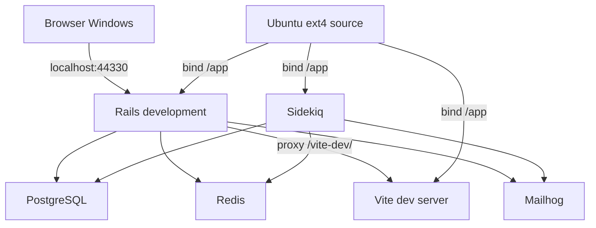

# Môi trường local và hiệu năng

Ngày: **18/11/2026, UTC+07**. Source khảo sát: Chatwoot `v4.19.1` / `caab07a8f00032d5205b5a5d7e2eb0ba2f3d2d82`, nhánh local `codex/wsl-migration`. Đây không phải commit chứa báo cáo; commit báo cáo xem lịch sử nhánh `review/project-foundation`. [Điểm bắt đầu](README.md).

## Phân loại môi trường và lý do chọn

**Quan sát:** Rails/Node ở development, Vite dev server, Sidekiq/PostgreSQL/Redis/Mailhog; source bind mount. Không có deployment production riêng hoặc production assets benchmark đối chứng. Rails/Vite là image development đã build từ source, giữ/nạp sang Desktop; data services dùng images upstream được pin bằng image ID trong override local.

**Lý do có văn bản lúc triển khai:** hồ sơ 11/11 ghép hướng dẫn Chatwoot Docker development và Docker Engine Ubuntu, source ở managed Windows worktree. Chưa thấy phân tích trước quyết định giải thích ưu tiên Engine hơn Desktop hoặc đánh đổi source Windows. Chẩn đoán sau chạy mới ghi mục đích tích hợp managed worktree; đây là giải thích nhìn lại. Phương án 17/11 ghi yêu cầu người dùng chuyển Desktop, dùng Linux source, giữ pin/dữ liệu và review trước cutover.

**Nhận định bổ sung:** current model phù hợp phát triển backend/frontend theo [Docker development của Chatwoot](https://developers.chatwoot.com/contributing-guide/environment-setup/docker), không có bằng chứng là nhanh nhất. Không dùng Docker development làm đại diện hiệu năng production. Webhook ngoài/điện thoại thật chưa có endpoint đã kiểm.



## Máy, WSL và engine — E02

Snapshot 18/11 khoảng 00:04–00:16, không phải capacity test.

| Thành phần | Quan sát |
| --- | --- |
| Windows | Windows 11 Pro 10.0.26200; WSL hiển thị build 26200.9974 |
| CPU | i7-9850H, 6 nhân / 12 luồng |
| RAM | 31.72 GiB; free Windows khoảng 14.73 GiB lúc kiểm đầu |
| Đĩa | C tổng 328.84 GiB, trống 36.57 GiB; D tổng 146.48 GiB, trống 88.96 GiB |
| WSL / distro | WSL 3.0.5.0, kernel 6.18.58.1; Ubuntu 22.04.5 LTS, WSL2 |
| Desktop / Engine / Compose | Docker Desktop 4.99.0 (245822), Engine/CLI 29.9.3, Compose 5.7.0 |
| Engine resources | 12 CPU, MemTotal 16624914432 bytes (~15.48 GiB) |
| WSL config | Có networkingMode=mirrored; không thấy memory/processors/swap tường minh |
| Memory sau đo | Khoảng 12 GiB available; swap 4 GiB, used 0 |
| Container limits | Memory/NanoCpus/CpuQuota không đặt giới hạn riêng |

[Microsoft WSL settings](https://learn.microsoft.com/en-us/windows/wsl/wsl-config#main-wsl-settings) mô tả mặc định memory 50% RAM và processors theo logical CPUs; không từ đó suy mọi effective setting của máy này đúng mặc định. Swap actual 4 GiB được quan sát riêng, không diễn giải lại thành số mặc định lý thuyết.

Windows context `desktop-linux`; Ubuntu context `default` qua `unix:///var/run/docker.sock`; CLI Ubuntu resolve tới `/mnt/wsl/docker-desktop/cli-tools/usr/bin/docker`. Cả hai trả cùng engine ID. Native docker.service/docker.socket/containerd.service của Ubuntu inactive. Có lưu data Engine cũ, không có bằng chứng hai daemon active đồng thời. Không thay context hoặc agent environment trong khảo sát.

## Source, filesystem và storage — E03

Root source thực: `/root/code/chatwoot-worktrees/wsl-preflight` trên `/dev/sdd`, ext4. Git common repository `/root/code/chatwoot-repository`. Chat Codex/PowerShell đang gắn checkout Windows cũ `C:/Users/MFLAT-ADS-010/.codex/worktrees/chatwoot-dev-setup/chatwoot`. Chưa xác minh IDE/Git panel chuyển sang Linux; kiểm tiến trình Code không thấy VS Code trong lần kiểm. Không kết luận mọi công cụ đã đổi workspace.

| Thành phần | Đường dẫn thực tế | Nơi lưu | Sử dụng / kiểu mount |
| --- | --- | --- | --- |
| Code | `/root/code/chatwoot-worktrees/wsl-preflight` | Ubuntu ext4 | Rails/Vite/Sidekiq bind vào `/app` |
| Connector riêng | Chưa tìm thấy trong phạm vi đã khảo sát | Chưa xác lập | Chưa có |
| Compose | Root trên + `/docker-compose.yaml`, `/.codex/compose.lab.yaml`, `/.codex/compose.desktop.yaml` | Ubuntu ext4 | CLI đọc; files cũng ở bind /app |
| Gems thực dùng | `/gems/ruby/3.4.0/gems` | Image + writable layer | Rails/Sidekiq, không mount /gems |
| Volume bundle | `/var/lib/docker/volumes/cwlab-9200023e_bundle/_data` | Docker Desktop managed disk | mount `/usr/local/bundle`, không phải effective BUNDLE_PATH |
| JS dependencies | `/var/lib/docker/volumes/cwlab-9200023e_node_modules/_data` | Docker Desktop managed disk | mount `/app/node_modules` vào app services |
| PostgreSQL | `/var/lib/docker/volumes/cwlab-9200023e_postgres/_data` | Docker Desktop managed disk | mount `/data/postgres`; SHOW data_directory xác nhận |
| Redis | `/var/lib/docker/volumes/cwlab-9200023e_redis/_data` | Docker Desktop managed disk | mount `/data`, RDB dump.rdb, appendonly=no |
| Upload | `/root/code/chatwoot-worktrees/wsl-preflight/storage` | Ubuntu ext4 | qua bind `/app`; không named storage volume riêng |
| Rails/build cache | `/var/lib/docker/volumes/cwlab-9200023e_cache/_data` | Docker Desktop managed disk | mount `/app/tmp/cache` |
| Packs | `/var/lib/docker/volumes/cwlab-9200023e_packs/_data` | Docker Desktop managed disk | mount `/app/public/packs` |
| Vite cache | `/app/node_modules/.vite` | volume node_modules | Vite ghi |
| Node compile cache | `/tmp/node-compile-cache/...` | writable layer Vite | không volume riêng |

Các `/var/lib/docker/...` trong bảng là đường ở **daemon Desktop**, không được nhầm với directory cùng tên của Engine cũ trong Ubuntu. Vite inspect có thể biểu diễn source qua `/run/desktop/mnt/host/wsl/docker-desktop-bind-mounts/Ubuntu-22.04/...`; Compose resolved và checksum cho thấy Linux source.

Đĩa source Ubuntu nằm trong `C:/Users/MFLAT-ADS-010/AppData/Local/wsl/{423b648b-df64-4178-b913-db88d10b708e}/ext4.vhdx` (~16.54 GiB file size). Đĩa data Desktop: `C:/Users/MFLAT-ADS-010/AppData/Local/Docker/wsl/disk/docker_data.vhdx` (~7.68 GiB). Source ở Linux filesystem vẫn chiếm C qua VHDX. 947 GiB available logic trong Ubuntu không phải free C. Các số file size không phải physical allocation kiểm bằng allocated ranges.

Có anonymous PG volume tại `/var/lib/postgresql/data`, nhưng actual PGDATA là `/data/postgres`; không kết luận anonymous volume chứa DB đang dùng.

Bind /app che code trong image; named volumes che node_modules/packs/cache tương ứng. [Docker mô tả cơ chế che nội dung khi mount](https://docs.docker.com/engine/storage/volumes/#mounting-a-volume-over-existing-data). Source Linux phù hợp [Docker WSL bind/inotify guidance](https://docs.docker.com/desktop/features/wsl/best-practices/). Chưa sửa tệp để kiểm filewatch/HMR; handshake HMR không thay phép thử đó.

E03 kiểm Gemfile.lock, pnpm-lock.yaml, .git_sha, app/javascript/entrypoints/dashboard.js giữa Linux host và Rails/Vite/Sidekiq: khớp. Đây không phải full tree identity hoặc IDE verification.

## Images và dịch vụ — E04

| Service | Reference / image ID | Port Windows | Snapshot CPU / RAM 00:06 |
| --- | --- | --- | --- |
| Rails | `cwlab-9200023e:rails-caab07a8f000`, ID rails phía dưới | 127.0.0.1:44330 -> 3000 | 0.03% / 333 MiB |
| Sidekiq | cùng image Rails | không publish | 6.45% / 423 MiB |
| Vite | `cwlab-9200023e:vite-caab07a8f000`, ID vite phía dưới | 127.0.0.1:44331 -> 44331 | 0.33% / 832 MiB |
| PostgreSQL | ID pg phía dưới, dòng pgvector/PostgreSQL16 | không publish | 0.20% / 70 MiB |
| Redis | ID redis phía dưới | không publish | 0.58% / 7 MiB |
| Mailhog | ID mailhog phía dưới | 127.0.0.1:44332 -> 8025 | 0% / 2 MiB |

```text
rails/sidekiq sha256:66d3ff2ac71dfe104454be166f22118676df59c8dea5d39ad77b4ad23b70ce87
vite          sha256:bc1d3fa91959c4fe21fba1eaf767048ccc94f884e8feacf3c595ca15a53b9889
pg            sha256:0dd3149a06e4579a0d70d8fef9945636cd514005e7237deb27f9b67886f8dc4f
redis         sha256:71885d8cc6e42f2bc0aa2eb853bfc4be200b5108a46ac50e117ae1df0531fb80
mailhog       sha256:8d76a3d4ffa32a3661311944007a415332c4bb855657f4f6c57996405c009bea
```

Sáu containers running, restart count=0, OOMKilled=false tại khảo sát; PG/Redis restart always, còn lại no. Recheck lúc soạn bộ report vẫn đủ sáu running; không đo lại toàn bộ resource hoặc hiệu năng. Runtime Ruby3.4.4/Node24.22.1/pnpm10.2.0, PostgreSQL16.15 khớp các mốc tương ứng đã đối chiếu. Image ID không thay kiểm code bind; images có thể dùng OCI index/child manifest, không suy label digest khác index là đổi image.

## Đo tốc độ — E06, chưa biết nguyên nhân gốc

Ngày 18/11, khoảng 00:07:35. Mỗi endpoint 3 lần, curl IPv4/no-proxy, không restart, hai nhóm Windows/WSL chạy gần đồng thời. Đây là tổng thời gian ms, không là UI render hoặc cold-start.

| Endpoint | Windows 1/2/3 (ms) | WSL 1/2/3 (ms) | Status |
| --- | --- | --- | --- |
| /health | 35 / 29 / 8 | 7 / 9 / 6 | 200 |
| /api | 71 / 13 / 17 | 19 / 14 / 15 | 200 |
| /app/login | 175 / 167 / 133 | 146 / 94 / 189 | 200 |
| /vite-dev/@vite/client | 35 / 23 / 12 | 16 / 34 / 27 | 200 |

Trình duyệt Windows trong ứng dụng, giữ session/cache mặc định, không tạo lại cold start. Navigation/Paint Timing đọc qua CDP, khoảng00:08–00:12. URL là localhost:44330/app/accounts/{labAccount}/conversations/{labConversation}; bỏ identifiers trong bản publish.

| Lượt | HTML TTFB (s) | DOMContentLoaded (s) | Load (s) | FCP (s) |
| --- | --- | --- | --- | --- |
| mở tab lần đầu khảo sát | .418 | 11.658 | 11.716 | 12.380 |
| reload1 | .442 | 16.655 | 16.929 | 12.284 |
| reload2 | .113 | 14.673 | 14.691 | 12.080 |
| reload3 | .655 | 13.907 | 13.964 | 12.068 |

Sau các lượt editor/nội dung hiển thị. FCP không là app-ready. Một số lệnh selector timeout dù quan sát sau thấy editor. Resource Timing buffer chỉ250; CDP trace truncated cả khi thu theo cursor. Phần trace thu được có hàng nghìn responses /vite-dev nhưng không phải tổng modules duy nhất hoặc waterfall đầy đủ. Không có trace gốc được publish; số liệu là bản trích tool output của cuộc khảo sát, không tái đo trong lúc viết report. Browser/tool overhead chưa định lượng.

Source gem đang cài `vite_ruby-3.10.6` có DevServerProxy chuyển assets tới Vite; Vite Rails engine chèn middleware. [Cấu hình Vite Ruby](https://vite-ruby.netlify.app/config/) là tài liệu live tham khảo, không pin theo gem. Chưa chứng minh tầng proxy đóng góp bao nhiêu giây.

Sampling Docker 00:10:20–00:11:07 bao phủ reload đầu: Rails CPU peak 124%, Vite 280%, PG 3.73%, Redis <1%; RAM biến động nhỏ, không swap/OOM. CPU cộng trên lõi, không phải280% toàn máy. 20 phút log chọn lọc khoảng 00:13: không thấy 5xx/connectivity errors/restart loop; 169 dòng timing Rails có max DB 288 ms / max total 586 ms, không bao phủ mọi proxy request. Không thấy re-optimization Vite trong đoạn log đã đọc. Console error captured0; limits404 được source quy định ngoài Cloud. Handshake /cable101 và ViteWebSocket101 được quan sát, không là end-to-end realtime/HMR.

**Đã xác nhận:** UI xuất hiện chậm, phần chờ lớn sau HTML ban đầu; reload không trở thành tức thời. **Giả thuyết:** graph modules development, transform/execute, Rails proxy, browser/tool overhead. **Chưa có dữ liệu:** CPU profile/long tasks, complete waterfall, Chrome thường cùng điều kiện, production-build đối chứng, cold-start thật. Không kết luận thiếu RAM, DB hoặc filesystem là nguyên nhân.

## Đối chiếu chính thức

[Compose pin](https://github.com/chatwoot/chatwoot/blob/caab07a8f00032d5205b5a5d7e2eb0ba2f3d2d82/docker-compose.yaml) đủ các development services; local đổi ports/Dockerfiles. [Production Compose pin](https://github.com/chatwoot/chatwoot/blob/caab07a8f00032d5205b5a5d7e2eb0ba2f3d2d82/docker-compose.production.yaml) dùng production image/storage, không Vite/Mailhog/source bind. [Live production guide](https://developers.chatwoot.com/self-hosted/deployment/docker) chưa có snapshot v4.19.1; không áp dụng mù lệnh build/reset của guide vào dữ liệu hiện có. Xem S01–S08 và phép chưa chạy trong [evidence.md](evidence.md).
